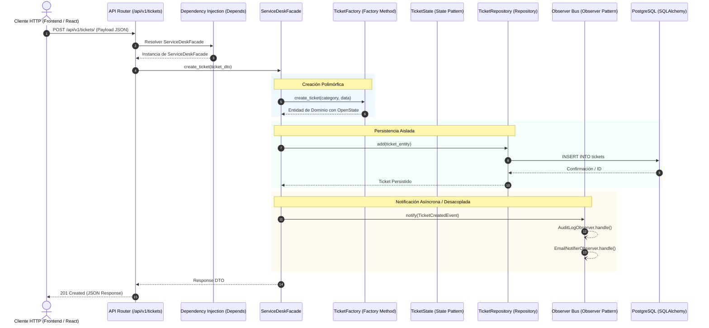

# Architecture Guidelines - Unified Service Desk

## 1. Visión General de la Arquitectura
El sistema **Unified Service Desk** está concebido bajo los principios de **Clean Architecture** estructurado como un **Monolito Modular (Modular Monolith)**. El objetivo es garantizar alta cohesión, bajo acoplamiento, alta testabilidad y la erradicación de antipatrones como el *God Object* y el *Spaghetti Code*.

Toda la lógica de negocio y las operaciones sobre los tickets están desacopladas de la infraestructura de persistencia y de la capa web de presentación.

---

## 2. Estructura de Carpetas (`/backend`)

```text
backend/
├── api/                     # Capa de Presentación (Controladores / Routers)
│   ├── v1/
│   │   ├── endpoints/       # Endpoints HTTP (tickets, healthcheck, etc.)
│   │   └── router.py        # Agrupador central de rutas v1
│   └── dependencies.py      # Proveedores de Inyección de Dependencias (FastAPI Depends)
│
├── core/                    # Núcleo de Configuración e Infraestructura
│   ├── config.py            # Settings de la aplicación (Pydantic BaseSettings)
│   └── database.py          # DatabaseManager (Patrón Singleton para SQLAlchemy Engine/Session)
│
├── domain/                  # Capa de Dominio (Entidades y Reglas de Negocio Puras)
│   ├── models/              # Modelos de SQLAlchemy (persistencia)
│   ├── schemas/             # Esquemas de Pydantic (validación DTO de entrada y salida)
│   ├── states/              # Patrón State (OpenState, InProcessState, ResolvedState, ClosedState)
│   └── factories/           # Patrón Factory Method (TicketFactory, HardwareTicket, SoftwareTicket, AccessTicket)
│
├── repositories/            # Capa de Acceso a Datos (Patrón Repository)
│   ├── base.py              # Interfaz abstracta base (TicketRepositoryInterface)
│   └── ticket_repository.py # Implementación concreta usando SQLAlchemy (SQLAlchemyTicketRepository)
│
├── services/                # Capa de Aplicación y Orquestación
│   ├── observers/           # Patrón Observer (TicketSubject, AuditLogObserver, EmailNotifierObserver)
│   └── service_desk_facade.py # Patrón Facade (Punto único de orquestación de negocio)
│
└── main.py                  # Entrypoint de la aplicación FastAPI y ciclo de vida (Lifespan)
```

---

## 3. Patrones de Diseño GoF Implementados

| Patrón | Ubicación | Responsabilidad Arquitectónica |
| :--- | :--- | :--- |
| **Singleton** | `core/database.py` (`DatabaseManager`) | Garantiza una única instancia de inicialización de motor de base de datos (`Engine`) y generador de sesiones (`sessionmaker`), centralizando el pool de conexiones a PostgreSQL. |
| **State** | `domain/states/` | Modela el ciclo de vida del ticket (`Open`, `In Process`, `Resolved`, `Closed`). Cada estado encapsula sus transiciones y reglas válidas, eliminando bloques condicionales anidados (`if/elif`). |
| **Factory Method** | `domain/factories/` | Permite la instanciación polimórfica de subtipos de ticket (`HardwareTicket`, `SoftwareTicket`, `AccessTicket`), aplicando reglas de negocio, prioridades por defecto y campos específicos según la categoría. |
| **Repository** | `repositories/` | Aísla la capa de dominio de la tecnología del ORM (SQLAlchemy) mediante abstracciones (`TicketRepositoryInterface`). Los servicios operan contra contratos de interfaz. |
| **Observer** | `services/observers/` | Sistema desacoplado de eventos y notificaciones. Al mutar el estado o crearse un ticket, los observadores registrados (`AuditLogObserver`, `EmailNotifierObserver`) reaccionan automáticamente. |
| **Facade** | `services/service_desk_facade.py` | Punto de entrada unificado para todas las operaciones de casos de uso. Orquesta validaciones, fábricas, máquina de estados, persistencia en repositorio y despacho a observadores. |

---

## 4. Flujo de Interacción entre Capas

El flujo de ejecución sigue una dirección unívoca de dependencias hacia el dominio (Inward Dependency Rule):



---

## 5. Reglas Arquitectónicas y Políticas Estrictas

1. **Aislamiento Absoluto de la API:**
   - Queda estrictamente prohibido importar o invocar `Session`, `Engine`, o modelos ORM de SQLAlchemy directamente dentro de las funciones de ruta de `api/v1/`.
   - Los routers de FastAPI únicamente consumen métodos públicos de `ServiceDeskFacade`.

2. **Inyección de Dependencias Nativa:**
   - Cada componente (`DatabaseManager`, `TicketRepository`, `ServiceDeskFacade`) se resuelve a través de `fastapi.Depends`.
   - Esto habilita la sustitución inmediata de repositorios para pruebas unitarias con mocks o bases de datos en memoria.

3. **Cero Antipatrones (Anti-God Object):**
   - Cada archivo debe tener una única responsabilidad bien definida (Single Responsibility Principle).
   - Las validaciones residen en los esquemas Pydantic y en las reglas de fábrica.
   - Las transiciones residen en las clases de estado.
   - La persistencia reside en los repositorios.
   - `main.py` contiene exclusivamente el bootstrap y configuración de middleware/routers de la aplicación.
