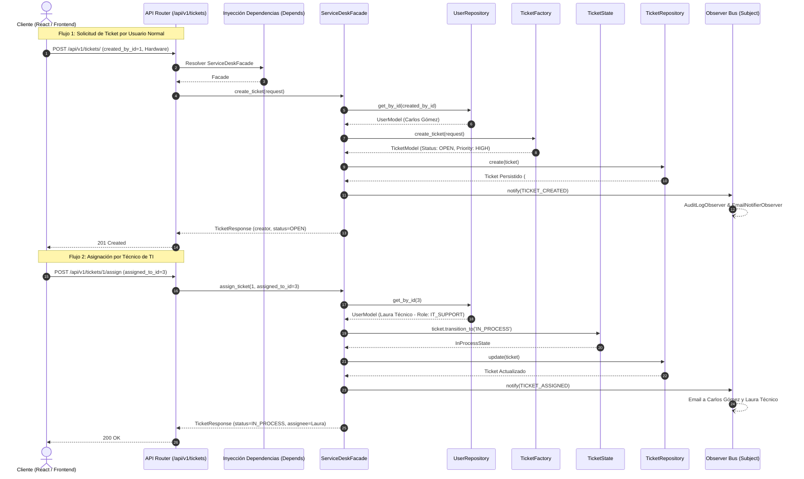

# Architecture Guidelines - Unified Service Desk

## 1. Visión General de la Arquitectura
El sistema **Unified Service Desk** está concebido bajo los principios de **Clean Architecture** estructurado como un **Monolito Modular (Modular Monolith)** con soporte para **Control de Acceso Basado en Roles (RBAC)**. El objetivo es garantizar alta cohesión, bajo acoplamiento, alta testabilidad y la erradicación total de antipatrones como el *God Object* y el *Spaghetti Code*.

Toda la lógica de negocio, validación de roles y operaciones sobre los tickets están estrictamente desacopladas de la infraestructura de persistencia y de la capa web de presentación.

---

## 2. Estructura de Carpetas (`/backend`)

```text
backend/
├── api/                     # Capa de Presentación (Controladores / Routers)
│   ├── v1/
│   │   ├── endpoints/       
│   │   │   ├── tickets.py   # Endpoints de Tickets (consumen únicamente la Fachada)
│   │   │   └── users.py     # Endpoints de Usuarios y Roles RBAC
│   │   └── router.py        # Agrupador central de rutas v1
│   └── dependencies.py      # Proveedores de Inyección de Dependencias (FastAPI Depends)
│
├── core/                    # Núcleo de Configuración e Infraestructura
│   ├── config.py            # Settings de la aplicación (Pydantic BaseSettings)
│   └── database.py          # DatabaseManager (Patrón Singleton para SQLAlchemy Engine/Session)
│
├── domain/                  # Capa de Dominio (Entidades y Reglas de Negocio Puras)
│   ├── models/              
│   │   ├── user.py          # Modelo UserModel (id, email, full_name, role, department)
│   │   ├── ticket.py        # Modelo TicketModel (relaciones creator, assignee, state)
│   │   └── audit_log.py     # Modelo AuditLogModel (trazabilidad de eventos)
│   ├── schemas/             
│   │   ├── user.py          # DTOs de Usuario y Enum UserRole (USER, IT_SUPPORT, ADMIN)
│   │   └── ticket.py        # DTOs de Ticket, Asignación y Auditoría
│   ├── states/              # Patrón State (OpenState, InProcessState, ResolvedState, ClosedState)
│   └── factories/           # Patrón Factory Method (TicketFactory, HardwareTicket, SoftwareTicket, AccessTicket)
│
├── repositories/            # Capa de Acceso a Datos (Patrón Repository)
│   ├── base.py              # Interfaz abstracta base (TicketRepositoryInterface)
│   ├── ticket_repository.py # Implementación concreta usando SQLAlchemy (SQLAlchemyTicketRepository)
│   └── user_repository.py   # Repositorio de Usuarios (UserRepositoryInterface / SQLAlchemyUserRepository)
│
├── services/                # Capa de Aplicación y Orquestación
│   ├── observers/           # Patrón Observer (TicketSubject, AuditLogObserver, EmailNotifierObserver)
│   ├── exceptions.py        # Excepciones de negocio (TicketNotFoundError, UnauthorizedRoleActionError)
│   └── service_desk_facade.py # Patrón Facade (Punto único de orquestación de negocio y RBAC)
│
└── main.py                  # Entrypoint de la aplicación FastAPI, Lifespan y Seed Data
```

---

## 3. Modelo de Roles y Control de Acceso (RBAC)

El sistema define 3 roles jerárquicos estrictos:

| Rol | Privilegios y Responsabilidades | Vista Asociada en Frontend |
| :--- | :--- | :--- |
| **`USER` (Solicitante)** | Puede crear incidencias, consultar y dar seguimiento **exclusivamente a sus propios tickets creados**, ver el técnico asignado a su caso y solicitar reapertura formal (`OPEN`) si un caso cerrado aún persiste. No puede auto-asignarse tickets ni cambiarlos arbitrariamente a estados de resolución técnica. | **Portal de Autoservicio (`UserPortal.jsx`)** |
| **`IT_SUPPORT` (Técnico TI)** | Acceso a la cola global de incidentes. Puede tomar tickets sin asignar ("Tomar ticket"), reasignar a compañeros de TI, transicionar estados según la máquina de estados (`OPEN` $\rightarrow$ `IN_PROCESS` $\rightarrow$ `RESOLVED` $\rightarrow$ `CLOSED`) y ver logs de auditoría. | **Mesa de Ayuda TI Kanban (`KanbanBoard.jsx`)** |
| **`ADMIN` (Administrador)** | Control global del sistema. Posee todos los privilegios de TI más la administración completa del directorio de usuarios (crear usuarios, asignar roles `USER`, `IT_SUPPORT`, `ADMIN`), eliminar tickets y supervisar métricas corporativas. | **Panel de Administración (`AdminPanel.jsx`)** |

---

## 4. Patrones de Diseño GoF Implementados

| Patrón | Ubicación | Responsabilidad Arquitectónica |
| :--- | :--- | :--- |
| **Singleton** | `core/database.py` (`DatabaseManager`) | Garantiza una única instancia thread-safe (`threading.Lock`) para el pool de conexiones relacionales y la fábrica de sesiones `sessionmaker`. |
| **Factory Method** | `domain/factories/` | Instanciación polimórfica de subtipos de ticket (`HardwareTicket`, `SoftwareTicket`, `AccessTicket`), aplicando invariantes específicas y adjuntando el solicitante (`created_by_id`). |
| **Repository** | `repositories/` | Aísla la capa de dominio de la persistencia mediante `TicketRepositoryInterface` y `UserRepositoryInterface`. Consultas optimizadas con `joinedload` para eliminar problemas N+1. |
| **Facade** | `services/service_desk_facade.py` | Punto unificado de orquestación para todos los casos de uso (creación, asignación a especialistas, validación RBAC, máquina de estados, persistencia y eventos). Los routers de FastAPI interactúan **únicamente** con esta fachada. |
| **State** | `domain/states/` | Modela el ciclo de vida del ticket (`Open`, `In Process`, `Resolved`, `Closed`). Cada estado encapsula sus transiciones legales sin condicionales masivos (`if/elif`). |
| **Observer** | `services/observers/` | Despacho desacoplado de eventos ante creación, asignación y cambio de estado. Notifica en tiempo real a `AuditLogObserver` (registro en BD) y `EmailNotifierObserver` (despacho simulado a solicitante y especialista). |

---

## 5. Flujo de Interacción entre Capas (Secuencia)



---

## 6. Reglas Arquitectónicas y Políticas Estrictas

1. **Aislamiento Absoluto de la API:**
   - Queda estrictamente prohibido importar o invocar `Session`, `Engine`, o modelos ORM de SQLAlchemy directamente dentro de las funciones de ruta de `api/v1/`.
   - Los routers de FastAPI únicamente consumen métodos públicos de `ServiceDeskFacade`.

2. **Seguridad y Reglas de Negocio en RBAC:**
   - Los usuarios con rol `USER` únicamente pueden consultar sus propios requerimientos y no pueden forzar resoluciones técnicas.
   - Las asignaciones de tickets solo se pueden realizar a cuentas con rol `IT_SUPPORT` o `ADMIN`.

3. **Inyección de Dependencias Nativa:**
   - Cada componente (`DatabaseManager`, `TicketRepository`, `UserRepository`, `ServiceDeskFacade`) se resuelve a través de `fastapi.Depends`.
   - Habilita la sustitución inmediata para pruebas unitarias con mocks.

4. **Cero Antipatrones (Anti-God Object):**
   - Responsabilidad única por módulo.
   - `main.py` contiene exclusivamente el bootstrap y configuración de lifespan y routers.
