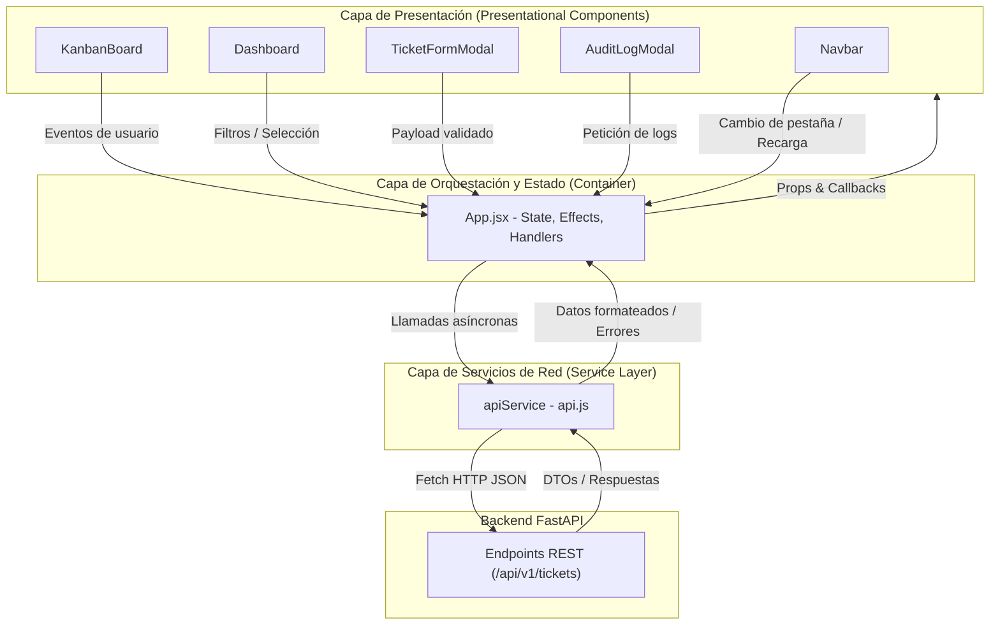

# Frontend - Unified Service Desk

Interfaz de usuario moderna y reactiva para el sistema **Unified Service Desk**, construida con **React 19**, **Vite** y **Tailwind CSS**. Implementa una arquitectura orientada a componentes (*Component-Driven Architecture*) desacoplada mediante una capa de servicios (*Service Layer*), reflejando visual y operativamente los patrones de diseño GoF del backend.

---

## 1. Arquitectura del Frontend

El frontend sigue los principios de alta cohesión y bajo acoplamiento, estructurado en tres capas fundamentales:

```text
frontend/src/
├── components/          # Capa de Presentación y UI Especializada
│   ├── Navbar.jsx           # Navegación global, branding e indicador de salud (Health Check)
│   ├── Dashboard.jsx        # Métricas, KPIs y distribución por fábrica/estado
│   ├── KanbanBoard.jsx      # Tablero ágil con transiciones basadas en el patrón State
│   ├── TicketFormModal.jsx  # Formulario polimórfico adaptativo (Factory Method UI)
│   └── AuditLogModal.jsx    # Visualizador de eventos de auditoría y notificaciones (Observer UI)
│
├── services/            # Capa de Abstracción de Red (Service Layer)
│   └── api.js               # Cliente HTTP centralizado que encapsula fetch y manejo de errores
│
├── App.jsx              # Capa de Orquestación y Estado de Aplicación (Smart Container)
├── main.jsx             # Punto de entrada y montaje en el DOM (React 19 Root)
├── index.css            # Directivas base de Tailwind CSS y tipografía
└── App.css              # Utilidades de animación y estilos globales
```

### Flujo de Datos y Capas



---

## 2. Patrones de Diseño Implementados en el Frontend

Aunque el backend implementa patrones GoF clásicos a nivel de dominio y arquitectura, el frontend los refleja y añade patrones arquitectónicos y de interfaz propios del ecosistema React:

| Patrón en el Frontend | Implementación | Responsabilidad y Beneficios |
| :--- | :--- | :--- |
| **API Service Layer / Gateway Client** | `src/services/api.js` (`apiService`) | Encapsula todas las peticiones HTTP (`fetch`), construcción de query parameters, cabeceras y manejo centralizado de excepciones. Los componentes nunca realizan llamadas de red directas. |
| **Container / Presentational Components** | `App.jsx` frente a `Dashboard`, `KanbanBoard`, etc. | `App.jsx` actúa como **Container** (maneja estado, ciclo de vida, notificaciones toast y lógica de negocio local), mientras que los componentes de `components/` se enfocan en renderizar interfaz y emitir eventos vía callbacks. |
| **Formulario Dinámico Polimórfico** *(Reflejo de Factory Method)* | `src/components/TicketFormModal.jsx` | Modela la interfaz según la categoría seleccionada (`HARDWARE`, `SOFTWARE`, `ACCESS`). Cada tipo renderiza un formulario especializado con metadatos específicos que corresponden 1:1 a las factorías del backend. |
| **UI State-Driven Transitions** *(Reflejo del patrón State)* | `src/components/KanbanBoard.jsx` | Las acciones de cada tarjeta de ticket son contextuales a su estado (`OPEN`, `IN_PROCESS`, `RESOLVED`, `CLOSED`). La UI solo expone las transiciones permitidas según el State Pattern del backend. |
| **Observer Event Viewer** *(Reflejo del patrón Observer)* | `src/components/AuditLogModal.jsx` | Proporciona una interfaz para auditar la traza de eventos generada por `AuditLogObserver` y revisar los correos simulados despachados por `EmailNotifierObserver`. |
| **Controlled Components & Unidirectional Data Flow** | Todos los componentes de formulario y filtros | Garantiza que el estado de React sea la única fuente de verdad (*Single Source of Truth*), previniendo inconsistencias de estado. |

---

## 3. Tecnologías y Herramientas

- **React 19**: Biblioteca para construcción de interfaces declarativas con el nuevo motor de concurrencia y hooks modernos (`useState`, `useEffect`).
- **Vite 8**: Servidor de desarrollo ultrarrápido con Hot Module Replacement (HMR) y empaquetador para producción.
- **Tailwind CSS 3**: Framework CSS utilitario para diseño responsivo, estética oscura (*Dark Theme* con tonos slate/indigo) y micro-interacciones.
- **Oxlint**: Linter de alto rendimiento para asegurar buenas prácticas y consistencia en el código JavaScript.

---

## 4. Requisitos Previos

- **Node.js**: Versión 18.x o superior.
- **npm**: Versión 9.x o superior.
- **Backend en ejecución**: El servidor FastAPI debe estar corriendo preferentemente en `http://localhost:8000`.

---

## 5. Instalación y Puesta en Marcha

### 1. Instalar dependencias
Desde la carpeta raíz del proyecto:
```powershell
npm --prefix frontend install
```
O ingresando al directorio `frontend`:
```powershell
cd frontend
npm install
```

### 2. Configurar Variables de Entorno (Opcional)
Por defecto, la API se conecta a `http://localhost:8000/api/v1`. Para modificar la URL base, cree un archivo `.env` en la raíz de `frontend/`:
```env
VITE_API_BASE_URL=http://localhost:8000/api/v1
```

### 3. Iniciar el Servidor de Desarrollo
```powershell
npm run dev
```
La aplicación estará disponible en [http://localhost:5173](http://localhost:5173).

### 4. Compilar para Producción
```powershell
npm run build
```
Los archivos optimizados se generarán en la carpeta `dist/`.

### 5. Ejecutar Linter
```powershell
npm run lint
```

---

## 6. Módulos y Pantallas Principales

1. **Dashboard General**:
   - Tarjetas de conteo rápido por estado y categoría.
   - Panel de incidencias críticas con atención prioritaria.
   - Métricas de distribución de tickets según su fábrica.

2. **Tablero Kanban**:
   - 4 columnas alineadas al ciclo de vida del patrón State: **Abiertos**, **En Proceso**, **Resueltos** y **Cerrados**.
   - Búsqueda en tiempo real por título, descripción o ID.
   - Filtro reactivo por categoría (Fábrica).
   - Acciones dinámicas de transición de estado con registro de motivo.
   - Acceso directo a la trazabilidad de auditoría de cada tarjeta.

3. **Modal de Creación Polimórfica (Factory Method)**:
   - Selección visual de la categoría del ticket:
     - **Hardware**: Solicita número de serie y tipo de dispositivo.
     - **Software**: Solicita nombre de software, versión y sistema operativo.
     - **Acceso & Seguridad**: Solicita sistema destino, rol y cuenta de usuario solicitante.
   - Envío de payload tipado al backend.

4. **Centro de Auditoría & Notificaciones (Observer)**:
   - Inspección cronológica del historial de cambios de estado y comentarios (`AuditLogObserver`).
   - Bandeja de salida simulada de correos electrónicos (`EmailNotifierObserver`) con remitente, destinatario, asunto y cuerpo.
